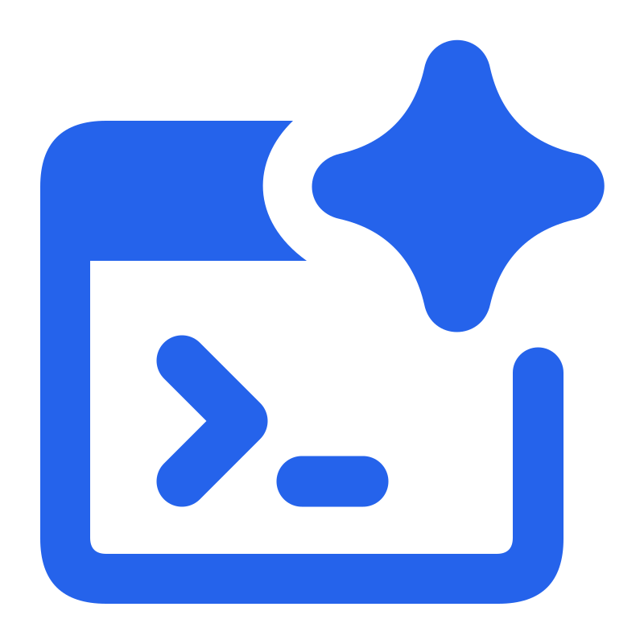

<p align="center">
  
</p>

<h1 align="center">React Boilerplate AI Ready</h1>

让 AI 按统一规范开发前端，也让人更容易接手和维护。

AI 可以很快生成页面，但在缺少项目约定时，不同任务、不同 Agent 可能选择不同的组件库、样式写法和数据处理方式。功能越多，越容易出现页面风格不一致、重复造组件、接口调用各写一套，以及换个项目就要重新解释开发要求的问题。

这个脚手架提前整理了技术选型、设计系统、公共组件、页面模板、接口与状态管理、表单反馈和测试方式，并通过 AGENTS.md、按任务组织的文档和项目 Skills，告诉 AI **用什么、去哪里找、按什么方式实现、完成后如何验证**。你可以直接描述业务需求，由 AI 结合项目已有能力开发，再通过浏览器查看和调整结果。

它同样支持人工阅读和编写代码。团队复用同一套基础和约定，有助于多个项目保持相近的目录、组件与业务实现方式，减少重新熟悉代码和交接的成本。

## 这个脚手架能帮你做什么

- **减少反复交代技术要求**：React + JavaScript、Vite、shadcn/ui 和 Tailwind CSS 已有明确分工，让 AI 优先沿用项目能力，避免随意混入另一套框架或组件库。
- **让页面有统一的设计依据**：三套设计预设、Design Tokens、布局和组件示例可直接复用；在 Design Playground 中预览、调整并保存项目外观，无需每个页面重新设计。
- **让业务代码沿用同一套路**：页面接入、异步接口、Redux、表单校验与操作反馈都有对应规范，减少同类功能出现多种写法。
- **没有后端也能先看效果**：已有登录与用户 Mock，可以独立启动；新业务沿用真实请求入口扩展模拟接口，方便先验证界面和流程。
- **让 AI 写完后有办法检查**：Vitest、组件测试和 Playwright 提供逻辑、交互、手机布局及截图验证能力，便于 AI 根据检查结果修复并再次验证。
- **方便换成自己的产品**：产品名称、Logo 和外观可以统一替换；默认使用向导提供简短提示词，开始业务开发后可由 AI 换成正式业务入口。

## 技术选型为什么适合 AI 协作

- **shadcn/ui：AI 可以直接阅读组件源码。** 按需引入的组件源码就在项目里，AI 能检查真实 API、结构和样式，再组合或封装业务界面；人也能审查和调整。统一的组合方式配合官方示例，有助于减少猜测组件用法和重复开发基础控件。[了解 shadcn/ui 的开放源码与 AI-Ready 设计](https://ui.shadcn.com/docs)。
- **Tailwind CSS：样式与界面结构放在一起。** 布局、间距、响应式和交互状态可通过组件中的工具类表达，AI 修改页面时能直接看到对应样式。结合本项目的语义 Design Tokens，调整品牌或主题时可以继续使用同一套组件，减少散落的颜色值和重复 CSS。这是本项目选择它来支持 AI 协作的工程考虑。[了解工具类的组合方式](https://tailwindcss.com/docs/styling-with-utility-classes)。
- **Registry：让组件有明确的发现与分发渠道。** shadcn/ui 的 Registry 可以描述组件源码、依赖及相关文件，配合 CLI 按需引入。项目要求 AI 先检查已有组件，再查询官方 Registry 与组合示例；官方 Skill / MCP 是可选增强，未安装时仍可通过文档、仓库和 CLI 完成查询与开发。
- **可以逐步扩展为团队自己的 Registry。** 后续可按 [shadcn Registry 协议](https://ui.shadcn.com/docs/registry) 分发团队组件、页面模板、Hooks 和配置，让不同项目及 AI Agent 复用已确认的实现，进一步保持代码与设计一致。当前仓库尚未搭建自建 Registry 服务；Playground 的 Component / Page Registry 是本地预览注册表，与可供 CLI 安装的组件分发 Registry 分工不同。
- **技术选型与项目规范一起使用。** JavaScript、Vite、统一请求与表单方案，以及现成的测试命令，为 AI 提供明确的实现和验证入口；AGENTS.md 与项目 Skills 约定何时复用、何时扩展，以及完成后要检查什么。组件源码可修改，但仍应优先复用、组合，按需求变更，避免无关重写。

## 如何阅读

| 你想做什么                     | 建议先看                                                                                              |
| ------------------------------ | ----------------------------------------------------------------------------------------------------- |
| 让 AI 帮你做产品、查看页面效果 | “开始开发”“无后端开发”“多主题 Design System”；也可以直接让 AI 启动项目，再查看页面里的使用向导        |
| 让 AI 创建或修改功能           | 让 Agent 先读 AGENTS.md，再按任务选择文档和 Skills；下面折叠的“AI Agent 阅读入口”无需由使用者逐篇研读 |
| 自己写代码、审查或维护项目     | 按需查看“环境配置”“技术栈和目录”及后续工程参考；这些内容也供 AI 使用                                  |
| 准备部署发布                   | 查看“环境配置”和“发布”，确认正式接口地址及部署方式                                                    |

不懂具体库名也可以先描述需求，例如：“帮我做一个设备管理功能，能搜索、新增、编辑和删除，先用模拟数据让我试用。”技术实现由 Agent 按项目规范选择，你负责确认业务要求和实际效果。

GitHub 仓库：https://github.com/ihahoo/react-boilerplate-ai-ready

## 开始开发

使用 Node.js 22.12+（22.x）、24.x 或 26+ 与 npm，建议使用 Node.js 22 或 24 LTS。

```bash
npm ci
npm run dev
```

开发地址为 `http://127.0.0.1:3000`。首次启动前，请在 `src/config.js` 中配置应用标题及各环境的后端地址。`yourdomain.com` 相关地址为示例，需要替换为实际服务地址。

<details>
<summary>AI Agent 阅读入口（使用者无需逐篇研读，手动开发时也可按需参考）</summary>

AI Agent 先读取 [AGENTS.md](AGENTS.md)，再根据任务选择相关章节，不要每次加载所有文档。未自动读取时，可以直接说：“先阅读 AGENTS.md，按项目规范完成这个需求。”不要求先图片设计或先制作原型：

- [设计系统](docs/design-system.md)：Design Profile、Token、字体、状态与布局。
- [Design Playground](docs/design-playground.md)：设计配置、组件 / 页面注册与验证。
- [AI Design Guidelines](docs/ai-design-guidelines.md)：图片设计、原型、图片转代码、组件和业务开发四种独立能力。
- [页面模板](docs/page-templates.md)：当前模板用途和复用边界。
- [Redux 与异步接口开发](docs/redux-development.md)：领域四文件模板、列表详情、增删改、普通 thunk、错误和并发边界。
- [业务开发指南](docs/development.md)：路由、Redux、接口、表单与 Mock 详细示例。
- [shadcn 查询与可选工具](docs/shadcn-discovery.md)：官方文档、仓库及 CLI 查询；Skill / MCP 可选，不要求安装。
- [项目 Skills 使用与验证](docs/agent-skills.md)：页面与组件开发流程、Agent 发现检查和可选兼容方式。
- [表单开发](docs/form-development.md)：React Hook Form + Zod、FieldError、Sonner、Tooltip 与分页校验。
- [单元与组件测试](docs/unit-testing.md)：Vitest、React Testing Library 与既有 Node 测试的分工和示例。
- [浏览器验证](docs/browser-verification.md)：Playwright、Mock E2E、视觉基准、报告和 Trace。

这些文档供任意 AI Agent 使用；工具未自动读取 AGENTS.md 时，可显式让其从该文件开始。

</details>

## 无后端开发

没有配置后端服务时运行：

```bash
npm run dev:mock
```

打开 `http://127.0.0.1:3001`，使用账号 **admin**、密码 **admin123** 登录。模拟模式使用开发端口加 1，与普通开发的浏览器登录缓存隔离；也可通过 `--port` 显式设置端口。

模拟接口包括登录、用户信息、token 刷新、退出和修改密码。请求仍经过项目的 request、Redux 与路由鉴权流程，可以直接查看使用向导、调试布局和表单，无需启动后端或修改鉴权代码。

数据仅在开发服务内存中保存；修改密码会影响本次运行的后续登录，Vite 内部重载会保留会话和修改后的密码；停止并重新启动开发进程后密码恢复为 admin123，原有模拟会话失效。其他业务接口需要在 `vite/mock-api.mjs` 中按接口协议补充；未配置的 `/api` 请求返回明确的 404 JSON，不会转发到真实后端。

`npm run dev` 使用 `src/config.js` 的真实接口代理。模拟功能仅由 dev:mock 显式开启，不用于生产构建或 preview，也不会进入前端构建产物。

## 常用命令

```bash
npm run dev:mock        # 无后端开发，使用本地模拟接口
npm run dev             # 开发服务，支持 React Fast Refresh 和 CSS 热更新
npm run build           # 生产构建，输出 build/static
npm run build:staging   # 测试环境构建
npm run preview         # 本地预览构建产物
npm run clean           # 清理 build/static
npm run eslint          # 源码、Vite 配置和测试检查
npm run stylelint       # CSS 检查
npm test                # Vitest 与既有 Node 测试
npm run test:unit        # 纯逻辑单元测试
npm run test:components  # React 组件交互测试
npm run test:watch       # Vitest 监听模式
npm run test:e2e         # Playwright 桌面与手机验证
npm run test:e2e:production # 独立生产构建和浏览器检查
npm run test:mock       # 模拟接口和运行模式检查
npm run check:registry  # 组件 / 页面注册表检查
npm run test:design     # 设计系统与注册表测试
npm run format:check    # 格式检查
npm run format          # 格式化
```

## 多主题 Design System

本地默认显示“使用向导”，也可从右上角开发工具菜单再次打开。向导地址为 `/getting-started`，包含简短 AI 提示词与项目仓库链接，仅开发环境可用。首个业务模块接入时，将左侧向导菜单和默认首页替换为业务入口，具体步骤见 [业务开发指南](docs/development.md#首个业务模块与默认使用向导)。

本地开发时通过右上角开发工具（调色板图标）菜单进入设计系统，也可打开 `/design-playground` 无需登录预览三种预设：Modern SaaS、Industrial Pro、Creative AI。支持浅色 / 深色、三种信息密度及 Standard Admin / Workspace / Monitoring 布局。调整先在预览会话中生效，点击“保存到项目”后写入项目默认配置和 Token 覆盖，供后续开发与生产构建使用。

页面顶层分为“页面模板”和“组件库”。页面模板包含通用列表页、Dashboard、工业监测、静态 AI 工作台；组件库提供基础与公共组件的真实交互示例。示例使用静态数据，不接业务数据接口或 AI 服务，全局顶栏支持恢复已有登录态。

可手动调整 Token 并即时预览，支持暂存、撤销、恢复项目配置、保存到项目、导出已保存 JSON、导入 JSON 到预览以及复制给 AI Agent。保存写入 `src/design-system/project-design.json` 与 `src/design-system/tokens/project.css`，不会自动 Git 提交；源码修改由 Vite 热更新展示。左侧菜单不放设计系统入口，生产构建不提供 Playground 路由、顶部入口或设计配置写入接口。主题、布局、组件 API 与协作规则见 [设计系统文档](docs/design-system.md)。

## 环境配置

`src/config.js` 集中管理应用配置：

- `host`、`hotLoadPort`：本地开发服务地址和端口。
- `app.title`：产品名称，统一用于 Header、登录页、HTML 模板和页面标题。
- `app.showLogo`、`app.logoSize`、`app.logoSrc`：图形 Logo 开关、尺寸和替换图片，见 [Branding 规范](docs/design-system.md#branding示例品牌与个性化)。
- `environments`：`dev / staging / prod` 的接口地址及业务参数。

| 命令                    | Vite mode   | 应用环境 |
| ----------------------- | ----------- | -------- |
| `npm run dev`           | development | dev      |
| `npm run build:staging` | staging     | staging  |
| `npm run build`         | production  | prod     |

也可以通过 `STAGE=staging npm run build` 显式指定应用环境。配置修改后重启开发服务；环境配置在构建时确定，部署后修改进程环境变量不会改变已有产物。客户端配置会进入浏览器代码，不要放密钥。

开发环境的 `apiUrl` 为 `/api`。例如请求 `/api/authorizations` 时，Vite 会去掉 `/api` 前缀，转发到 `dev.proxyTarget` 对应的后端。staging 和 prod 使用各自的 `apiUrl`；直接跨域访问时，后端需要配置 CORS。

开发代理仅用于 `npm run dev`。生产部署如果使用相对 `/api` 地址，需要由部署服务器配置反向代理。

## 技术栈和目录

> 以下技术栈、UI、路由、资源与测试说明是工程参考，主要供 AI Agent 实现功能、开发者手写代码或审查时按需查阅。只描述需求和查看效果的使用者可以跳过；实际部署前仍需确认环境配置与发布要求。

- React 19、React Router 7、JavaScript / JSX
- Redux 5、React Redux、Redux Thunk、Reselect、Immer、redux-act-reducer
- shadcn/ui、Radix UI、Lucide 图标、Sonner 消息提示
- Tailwind CSS 4、CSS Modules、PostCSS
- Vite、ESLint、Prettier、Stylelint
- Design Tokens、AppearanceProvider、布局与开发态 Design Playground
- Vite 开发 Mock：模拟现有鉴权接口，业务调用入口与真实接口一致
- Vitest、React Testing Library、user-event、jest-dom、jsdom：单元与组件测试
- Node Test Runner：既有设计配置、数据处理与 Mock HTTP 测试
- React Hook Form + Zod：复杂表单、业务校验与类型转换；FieldError 统一字段反馈
- Playwright Test：页面交互、响应式、视觉比较与生产构建验证

```text
vite.config.mjs                       Vite 开发与构建配置
vitest.config.js                      Vitest 配置，复用 Vite 编译与别名
playwright.config.js                  Mock E2E、桌面/手机与视觉测试
playwright.production.config.js       独立生产构建和 preview 测试
vite/source-conventions.mjs           .js JSX 与 CSS Modules 文件处理
vite/mock-api.mjs                     开发模拟接口
vite/design-save.mjs                  开发态设计配置源码保存接口
components.json                      shadcn/ui CLI 配置
jsconfig.json                        编辑器路径别名与 JSX 配置
src/template/index.html              HTML 模板
src/index.js                         React 入口
src/config.js                        应用与环境配置
src/components/ui/                   shadcn/ui 基础组件（含 Field / FieldError）
src/components/                      页面布局和公共业务组件
src/components/AppLogo/              可替换的 SVG / 图片品牌图形
src/components/BrandIdentity/        Header、登录页共用的图形与产品名称
src/containers/                      登录、修改密码、使用向导和业务模块
src/containers/GettingStarted/        开发态使用向导与简短 AI 提示词
src/containers/DesignPlayground/      开发态页面模板、组件库与设计配置面板
src/containers/DesignPlayground/gallery/previews/FormExample/  RHF + Zod 可运行表单示例
src/design-system/appearance/        外观状态与主题应用
src/design-system/layouts/           标准后台、工作台和监测布局
src/design-system/tokens/            全局主题、密度及项目覆盖 CSS
src/design-system/project-design.json 已保存的默认外观、布局与 Token 覆盖
src/routes.js                        路由与登录保护
src/reducers.js                      Redux reducer 注册
src/utils/                           请求、鉴权、缓存、错误与跳转工具
src/utils/cn/index.js                 cn 样式合并工具
src/assets/css/main.css              Tailwind 入口与全局 Token 导入
tests/setup.js                      RTL 匹配器与测试状态清理
tests/unit/                         Vitest 纯逻辑测试（.test.js）
tests/components/                   RTL 组件交互测试（.test.jsx）
tests/*.test.mjs                    既有 Node 设计、数据与 Mock 测试
tests/e2e/                          Playwright 交互、生产与视觉测试
tests/e2e/visual/baselines/          仅存放人工确认的视觉基准
artifacts/e2e/                       生成的报告、截图和 Trace，Git 忽略
docs/                               设计、业务开发与测试文档
build/                               Express 静态服务与 Docker 发布文件
AGENTS.md                            AI 开发规范入口
```

`@/` 指向 `src/`，在 Vite 和 `jsconfig.json` 中配置。业务组件和普通逻辑使用 `.js`，支持 JSX；shadcn/ui 基础组件使用 CLI 生成的 `.jsx`。项目采用 JavaScript，不引入 TypeScript。

## UI 和样式

先检查项目公共组件和 Component Gallery，再查询缺失能力的官方文档、仓库或 CLI；官方 Skill / MCP 不是开发前提，也不会自动配置到用户环境。查询入口和示例见 [shadcn 查询与可选工具](docs/shadcn-discovery.md)。

优先组合 `src/components/ui/` 下的 shadcn/ui 组件。确认组件缺失且适用后按需添加：

```bash
npx shadcn@latest add dialog table select
```

`components.json` 的 `tsx: false` 指定生成 JavaScript 组件，生成文件使用 `.jsx` 后缀。

```jsx
import { Button } from '@/components/ui/button';
import { Input } from '@/components/ui/input';
import { Label } from '@/components/ui/label';

<form onSubmit={handleSubmit}>
  <Label htmlFor="name">名称</Label>
  <Input id="name" name="name" required />
  <Button type="submit">保存</Button>
</form>;
```

复杂业务表单推荐 React Hook Form + Zod，字段错误使用统一 FieldError；采用自定义错误 UI 的表单设置 noValidate，避免浏览器原生气泡重复提示。简单搜索、筛选等不强制使用表单库；上例仅展示基础控件组合。消息提示使用 Sonner 的 `toast.success()` / `toast.error()`，全局 `Toaster` 在 Root 中挂载。

日常样式优先使用 Tailwind，主题变量在 `src/design-system/tokens/` 中定义，由 `src/assets/css/main.css` 导入。业务 `.css` 默认启用 CSS Modules，可通过 `import styles from './styles.css'` 使用局部类名；全局选择器使用 `:global`。Tailwind 入口 `src/assets/css/main.css` 为全局样式，不启用 CSS Modules。PostCSS 支持 nesting、simple vars、mixins 和 Autoprefixer。

接入参考：[shadcn/ui Vite 安装文档](https://ui.shadcn.com/docs/installation/vite)、[Vite 文档](https://vite.dev/guide/)。

## 路由和数据

`src/routes.js` 中设置 `needAuth: true` 的路由由 `PrivateRoute` 校验 token。新增业务模块放在 `src/containers/<ModuleName>/`，按需创建 `actions.js`、`api.js`、`reducer.js`、`selectors.js`，并在 `src/reducers.js` 注册 reducer。

接口通过 `src/utils/api` 的 `request()` 发起，返回业务数据在 `res.body`。异步 action 使用 `createActionAsync`，reducer 处理 `REQUEST` / `SUCCESS` / `FAILURE`。错误用 `src/utils/error` 统一提取，在 effect 中展示。

## 模板和静态资源

HTML 模板位于 `src/template/index.html`，开发和构建共用。Vite 插件将它作为虚拟根入口加载，项目根目录无需创建 index.html。模板中的 `%APP_TITLE%` 根据应用配置替换，修改模板会触发浏览器刷新。

`<script type="module" src="/src/index.js"></script>` 声明 React 应用入口。构建时，Vite 会将其替换为带 hash 的 JS 产物链接，并生成独立 CSS 文件。

图片和字体使用 Vite 原生资源处理：小于 8 KiB 的资源可内联，较大资源输出为带 hash 的文件；ttf/eot 始终输出文件。

SVG 通过 `import logoUrl from './logo.svg'` 获取图片 URL，`?raw` 获取源字符串，CSS 中可使用 `url()`。通用界面图标使用 Lucide。

## 发布

`npm run build` 输出 `build/static`，可部署到支持 SPA 回退的静态服务器。非资源路由应回退到 `index.html`。

`build/server.js` 提供带 SPA 回退的 Express 静态服务，`build/Dockerfile` 用于容器部署。GitHub 部署流水线需根据项目的部署环境配置。

## 浏览器验证

使用 JavaScript 配置的 Playwright Test，支持独立 Mock E2E、桌面/手机交互、视觉候选和生产构建验证。

```bash
npm run test:e2e:install
npm run test:e2e
npm run test:e2e:visual:capture
npm run test:e2e:production
```

视觉基准须人工确认，不能自动更新以消除失败。命令、浏览器环境要求、报告与 Trace、Agent 工作流程见 [浏览器验证](docs/browser-verification.md)。

## 单元与组件测试

```bash
npm test
npm run test:unit
npm run test:components
npm run test:watch
```

Vitest + React Testing Library 负责纯逻辑和公共组件交互，已有 Node 测试保持不变，页面与真实浏览器验证继续使用 Playwright。分工、配置与示例见 [单元与组件测试](docs/unit-testing.md)。
